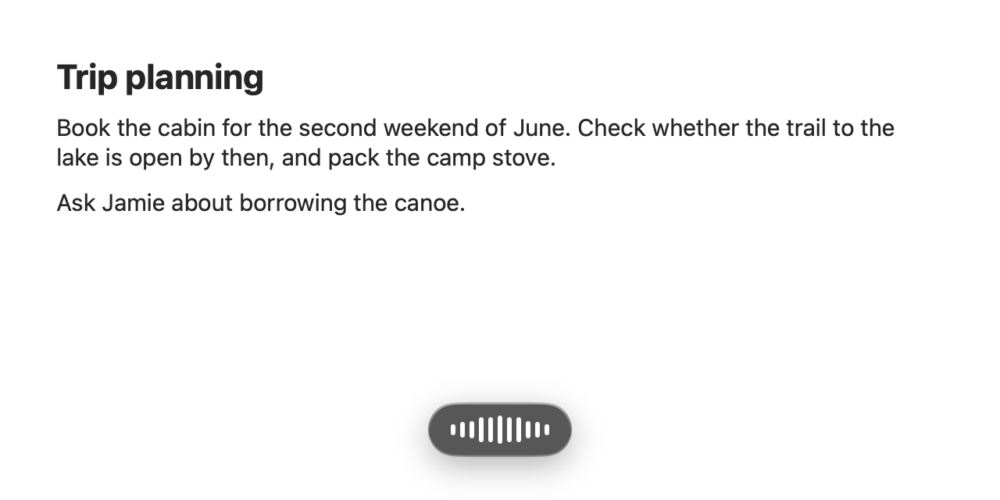
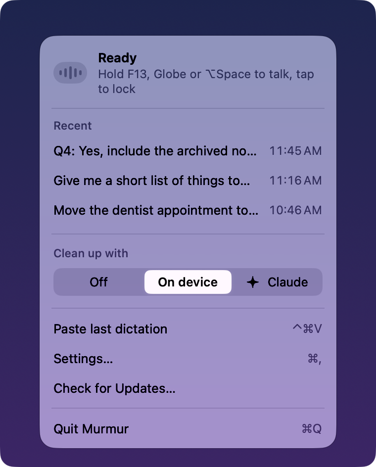

# Murmur

Murmur is a free, open-source dictation (speech-to-text) app for the Mac menu bar. Hold the Globe key or F13 while you speak, or tap it for hands-free voice typing and tap again to stop. Murmur transcribes offline on your Mac with NVIDIA's Parakeet model, cleans up the text, and pastes it into the app you were using.

<p align="center"></p>

I built Murmur because I wanted a dictation app that runs locally and is still nice to look at. By default, nothing leaves your Mac. It's a free alternative to Wispr Flow, Superwhisper, and the dictation built into macOS.

Murmur needs macOS 26 or later and about 580 MB of disk space for the speech model.

## Install

With [Homebrew](https://brew.sh):

```sh
brew install --cask austin-wiechman/tap/murmur
```

Or download `Murmur-<version>.dmg` from the [latest release](https://github.com/austin-wiechman/murmur/releases/latest), open it, and drag Murmur to the Applications folder.

### Open Murmur the first time

I sign Murmur with my own certificate instead of an Apple Developer ID, so Apple hasn't notarized it. A Developer ID costs $99 a year, which is more than this hobby project is worth to me. Because of that, macOS refuses to open Murmur the first time. To open it anyway:

1. Open Murmur once and dismiss the warning.
2. In **System Settings › Privacy & Security**, click **Open Anyway** next to the message about Murmur.

If you'd rather not run a binary I built, [build it from source](#build-from-source).

On first launch, Murmur's menu bar menu walks you through setup. It asks for Accessibility and Microphone access and whether to check for updates automatically. It also downloads the speech model.

## Choose how text is cleaned up

<p align="center"></p>

The menu has three cleanup options:

- **On device** uses Apple's on-device model, so nothing leaves your Mac. It needs Apple Intelligence turned on.
- **Claude** gives higher-quality cleanup through the [Claude Code](https://docs.anthropic.com/en/docs/claude-code) CLI and your Claude subscription, with no API key to set up. The transcript goes to Anthropic for that step. While you're offline, Murmur cleans up on device instead.
- **Off** pastes exactly what you said.

Murmur disables an option it can't use.

## Build from source

With Xcode 26 or later installed, run:

```sh
./scripts/install.sh
```

The script builds Murmur, installs it in `/Applications`, and opens it. To work on Murmur alongside an installed copy, see [CONTRIBUTING.md](CONTRIBUTING.md).

## How Murmur is built

[Claude Code](https://docs.anthropic.com/en/docs/claude-code) wrote nearly all of Murmur's code. I wanted a working dictation app without a big time investment, so expect some bugs and code that could be cleaner. That said, I've used Murmur as my own dictation tool for a while now, and it has been working well for me!

## Contributing

Pull requests are welcome. See [CONTRIBUTING.md](CONTRIBUTING.md) for what to expect and how to work on the code.

## Credits

- [FluidAudio](https://github.com/FluidInference/FluidAudio) runs Parakeet on the Neural Engine. Apache License 2.0.
- Murmur downloads NVIDIA's Parakeet speech model on first launch, under NVIDIA's license.
- [Sparkle](https://sparkle-project.org) handles updates. MIT License.

## License

Murmur uses the [MIT License](LICENSE).
